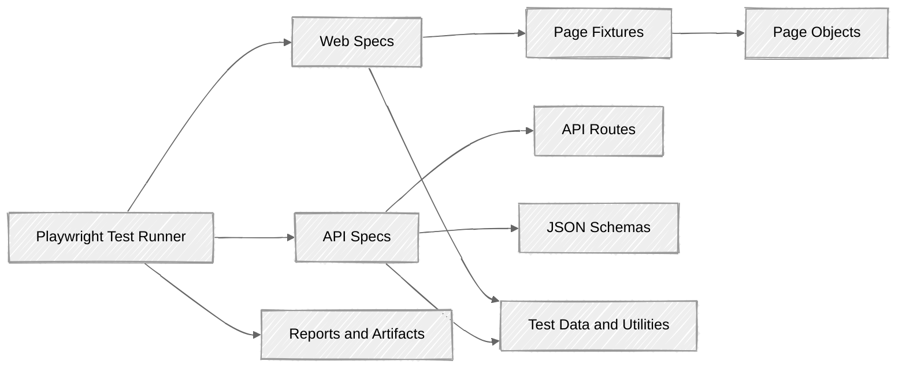
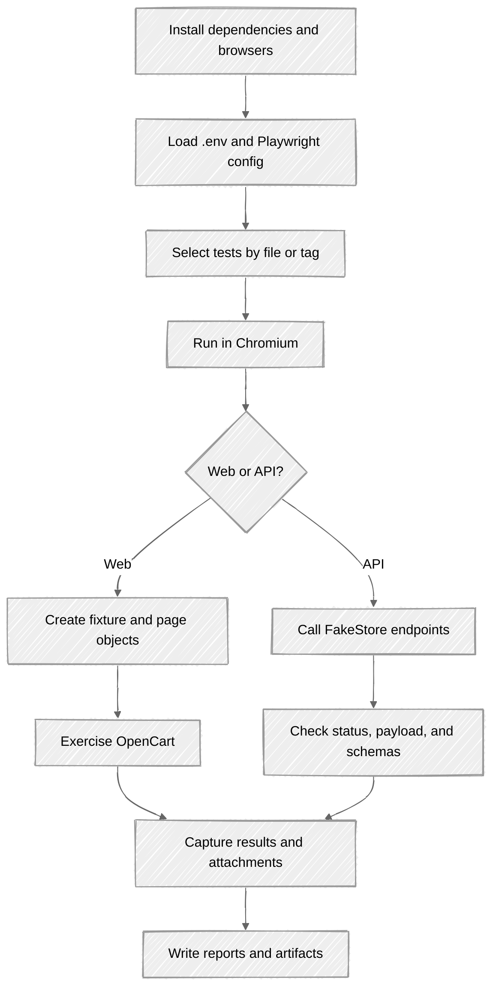
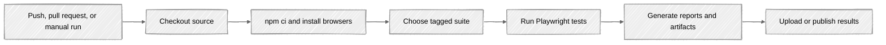

# Playwright OpenCart Automation

A TypeScript test automation project using Playwright Test to exercise OpenCart's demo storefront and the FakeStore REST API. It combines browser tests, API checks, reusable page objects and fixtures, data-driven scenarios, and multi-format reporting.

## Contents

- [What It Covers](#what-it-covers)
- [Architecture](#architecture)
- [Repository Layout](#repository-layout)
- [Prerequisites](#prerequisites)
- [Installation](#installation)
- [Configuration](#configuration)
- [Running Tests](#running-tests)
- [Framework Workflow](#framework-workflow)
- [Reports and Debugging](#reports-and-debugging)
- [Docker](#docker)
- [CI/CD](#cicd)
- [Utilities and Extensions](#utilities-and-extensions)
- [Known Limitations](#known-limitations)
- [Author](#author)

## What It Covers

- OpenCart browser scenarios for login, registration, logout, product search, cart actions, data-driven login, and an end-to-end shopping journey.
- FakeStore API scenarios for authentication, products, users, and carts, including CRUD requests and response-schema checks.
- Page Object Model classes and shared Playwright fixtures for common browser interactions.
- JSON, CSV, and Excel data readers, plus Faker-based test-data generation.
- HTML, JUnit XML, custom HTML, and Allure result output.
- Local, Docker Compose, GitHub Actions, and Jenkins execution paths.

Tests target public demo services by default. Use a test environment and non-production accounts; remote availability and data can change independently of this repository.

## Architecture



Web specs use `fixtures/pageFixtures.ts` to create the page objects in `pages/`. API specs call the endpoints defined in `api/endpoints/routes.ts` and validate selected responses against schemas in `api/schemas/`. Shared utilities provide data generation, file reading, database access, and custom reporting.

## Repository Layout

```text
.
├── api/
│   ├── endpoints/routes.ts       # FakeStore endpoint paths
│   └── schemas/                  # Product, user, and cart JSON schemas
├── fixtures/
│   └── pageFixtures.ts           # Shared page-object fixtures
├── pages/                        # OpenCart Page Object Model classes
├── tests/
│   ├── api/                      # Authentication, cart, product, and user specs
│   ├── db/                       # Reserved; no database specs are present yet
│   └── web/                      # OpenCart browser specs
├── testdata/                     # JSON, CSV, and Excel login data
├── utils/                        # Reporter, data, helper, and DB utilities
├── docs/                         # Framework guide and documentation prompts
├── prompts/                      # Test-generation prompt references
├── reports/                      # Playwright HTML/JUnit output (generated)
├── custom-report/                # Custom HTML output (generated)
├── allure-results/               # Allure raw results (generated)
├── allure-report/                # Optional generated Allure HTML report
├── test-results/                 # Playwright attachments and traces (generated)
├── playwright.config.ts          # Runner, browser, retry, and reporter settings
├── package.json                  # npm scripts and dependencies
├── .env.example                  # Environment variable template
├── Dockerfile
├── docker-compose.yml
└── Jenkinsfile
```

## Prerequisites

- Node.js LTS and npm.
- Internet access for installing browser binaries and reaching the demo application/API.
- Chromium, installed by Playwright during setup.
- Optional: Docker Engine with Docker Compose v2 to use the container workflow.
- Optional: a MySQL instance only if you call `utils/dbClient.ts` from your own tests or scripts.

The Playwright configuration currently enables the Chromium project. Firefox and WebKit project definitions are commented out.

## Installation

Clone the repository and enter its directory, then install the locked dependencies and Chromium:

```bash
npm ci
npx playwright install chromium
```

On Linux CI machines that need system packages as well as browser binaries, use:

```bash
npx playwright install --with-deps chromium
```

Create a local environment file from the template:

```powershell
Copy-Item .env.example .env
```

On macOS/Linux:

```bash
cp .env.example .env
```

Edit `.env` for the environment you intend to test. Never put production credentials in test data or commit secrets. The repository's `.gitignore` currently has its `.env` ignore entry commented out, so verify your local Git ignore setup before adding a real `.env` file.

## Configuration

`dotenv` loads `.env` for the web fixture, API specs, and database helper. The checked-in `.env.example` uses placeholders for credentials.

| Variable | Purpose | Use in this project |
| --- | --- | --- |
| `WEB_APP_URL` | OpenCart storefront base URL | Required by the shared web fixture. The example uses the OpenCart demo site. |
| `APP_EMAIL`, `APP_PASSWORD` | OpenCart customer login | Read by `Helper.getLoginDetails()` when that helper is used. Data-driven login scenarios read their rows from `testdata/`. |
| `API_BASE_URL` | API root URL | Optional; defaults to `https://fakestoreapi.com`. |
| `USER_ID`, `PRODUCT_ID`, `CART_ID`, `LIMIT`, `START_DATE`, `END_DATE` | API request parameters | Read by the related API specs; some specs provide fallback values. |
| `DB_HOST`, `DB_PORT`, `DB_USER`, `DB_PASSWORD`, `DB_NAME` | MySQL connection settings | Used by `utils/dbClient.ts`; no database test specs are currently present. |
| `APP_ENV`, `USERNAME`, `PASSWORD`, `PRODUCT_NAME`, `PRODUCT_QUANTITY`, `TOTAL_PRICE`, `ADMIN_USERNAME`, `ADMIN_PASSWORD` | Additional template values | Present in the template but not currently read by checked-in tests. Product details in `Helper` are currently hard-coded. |
| `TEST_ENV` | Environment label printed by the custom reporter | Optional; the reporter displays `QA` if it is unset. |

The successful FakeStore authentication test loads a user by `USER_ID` and uses that response's credentials; it does not read the `USERNAME` or `PASSWORD` variables. Do not copy real credentials into the committed data files.

## Running Tests

Run all discovered Playwright tests:

```bash
npx playwright test
```

The npm scripts select tests by tags in their titles:

| Command | Selection |
| --- | --- |
| `npm run test:api` | `@api` |
| `npm run test:web` | `@web` |
| `npm run test:master` | `@master` |
| `npm run test:sanity` | `@sanity` |
| `npm run test:regression` | `@regression` |
| `npm run test:e2e` | `@e2e` (no current test uses this tag; see [Known Limitations](#known-limitations)) |
| `npm run test:datadriven` | `@datadriven` |
| `npm run test:sanity:debug` | `@sanity` with Playwright Inspector/debug mode |
| `npm run test:master:headed` | Currently selects `@sanity` tests in headed mode; the script name does not match its tag filter. |

Useful direct Playwright commands:

```bash
# Run one spec
npx playwright test tests/web/valid-login-flow.spec.ts

# Filter by one or more title tags
npx playwright test --grep "@sanity"
npx playwright test --grep "@api|@regression"

# Choose Chromium and show the browser
npx playwright test --project=chromium --headed

# Open Playwright's interactive UI
npx playwright test --ui

# Debug a run
npx playwright test --debug
```

The default timeout is 30 seconds. Local runs use Playwright's default worker count and no retries; when `CI` is set, the config enables two retries, one worker, and headless mode. Failure screenshots and retained videos are enabled, with traces captured on the first retry.

## Framework Workflow



Test titles include tags such as `@sanity`, `@regression`, `@web`, `@api`, and `@master`; the npm scripts use Playwright's `--grep` filter to select those tests. The `@datadriven` tag identifies data-driven login scenarios. The end-to-end shopping scenario currently uses `@end-to-end`, not `@e2e`.

## Reports and Debugging

Every test run uses the reporters configured in `playwright.config.ts`:

| Output | Location | How to use it |
| --- | --- | --- |
| Playwright HTML | `reports/` | Open the latest report with `npx playwright show-report reports`. |
| JUnit XML | `reports/results.xml` | Integrate with CI systems that consume JUnit results. |
| Custom HTML | `custom-report/report_<timestamp>.html` | Open the generated file in a browser; includes run/test details and attached artifacts. |
| Allure results | `allure-results/` | Raw results for Allure. An Allure command-line installation is needed to generate/view an Allure HTML report. |
| Playwright artifacts | `test-results/` | Failure screenshots, videos, and traces when produced by the configured run. |

The HTML reporter is configured not to open automatically. To inspect a failure, open the Playwright HTML report or custom report, then use the corresponding screenshot, video, or trace attachment. The report folders are generated output and are not intended as source files.

To generate and open an Allure HTML report, install the Allure command-line tool separately, then run:

```bash
allure generate allure-results --clean -o allure-report
allure open allure-report
```

## Docker

Build the image and run all tests (the image's default command is `all`):

```bash
docker compose build
docker compose run --rm playwright-tests
```

Run a tagged suite or pass Playwright options:

```bash
docker compose run --rm playwright-tests web
docker compose run --rm playwright-tests api
docker compose run --rm playwright-tests sanity
docker compose run --rm playwright-tests web --headed --workers 2
```

Docker Compose reads environment variables from `.env` and mounts report/artifact folders back to the host. The project root is bind-mounted into the container, while the container's `node_modules` volume is kept separate. The `.dockerignore` excludes local environment files and generated artifacts from the image build context.

## CI/CD

### GitHub Actions

`.github/workflows/playwright.yml` runs for pushes and pull requests targeting `master`, and supports manual dispatch with suite, browser, and mode inputs. It installs dependencies and Playwright browsers, runs the selected tagged tests, and uploads the HTML, custom, and Allure result folders as artifacts.

**Current workflow mismatch:** the workflow's environment setup step still copies `.env.sample`, but this repository provides `.env.example`. The workflow should be updated to use `.env.example` before relying on its test job. The workflow also offers Firefox and WebKit choices, although only Chromium is currently configured in Playwright.

### Jenkins

The root `Jenkinsfile` defines a parameterized pipeline for suite, browser, and headed/headless mode. It installs npm dependencies and browsers, runs the selected npm script, archives reports, publishes JUnit/HTML/Allure results, and sends a build notification. It expects a Windows-capable agent with PowerShell and the required Jenkins Git, Allure, HTML Publisher, and Email Extension integrations. Its Firefox/WebKit parameters need matching Playwright projects enabled before those choices can run successfully.



## Utilities and Extensions

- `fixtures/pageFixtures.ts` loads the storefront URL and exposes typed page-object fixtures.
- `pages/` contains page classes for account, cart, home, login, logout, product, registration, and search-result interactions.
- `utils/DataReader.ts` reads JSON, CSV, and the first worksheet in Excel files.
- `utils/dataGenerator.ts` uses Faker to create customer, product, user, and cart test data.
- `utils/helper.ts` converts formatted prices and provides login/product helper values.
- `utils/dbClient.ts` executes parameterized MySQL queries and closes the connection in a `finally` block. It is a utility only; no database specs are checked in.
- `utils/CustomReporter.ts` writes a timestamped custom HTML report and run/test status details.
- `api/endpoints/routes.ts` centralizes FakeStore paths; `api/schemas/` contains response schemas validated with AJV.

The project includes `@axe-core/playwright`, but there are no active accessibility specs using it yet. `luxon` is also installed but is not currently used by the checked-in tests.

## Known Limitations

- The public OpenCart and FakeStore services can change or become unavailable; failures may be caused by external service state.
- Only Chromium is enabled in `playwright.config.ts` today.
- `npm run test:e2e` filters for `@e2e`, but the checked-in end-to-end shopping scenario is tagged `@end-to-end`; add or align tags before relying on that script.
- The GitHub Actions workflow refers to the old `.env.sample` filename, as noted above.
- The repository contains login test data intended for a demo environment. Review and replace it with approved non-production accounts before using a different target.
- Database and accessibility dependencies are present, but corresponding test suites are not currently implemented.

## Author

**Author:** Keerthi Krishna
